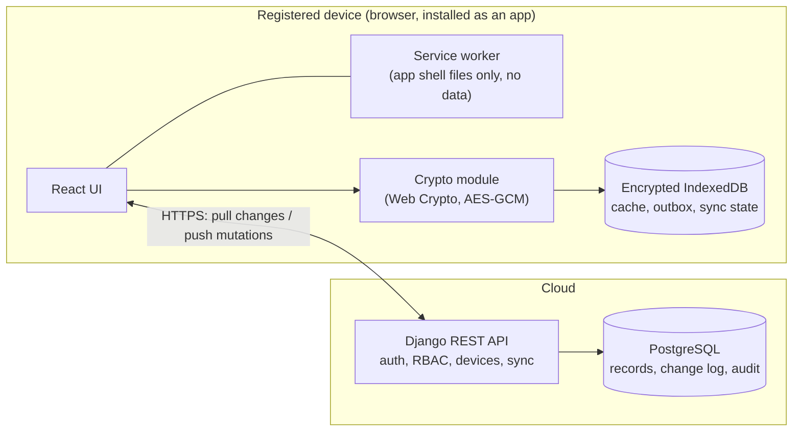

# TCOS Hybrid Cloud and Offline Architecture

Status: **design proposal for owner review. Not implemented.** Section 14 lists the decisions needed from the owner, with proposed defaults.

Source requirements: hybrid cloud database with offline capability, automatic synchronisation, device security, financial and approval controls, device management, and the five required test scenarios.

## 1. What "offline" means in TCOS

- One **central PostgreSQL database in the cloud** is the only source of truth.
- A user on a registered device can, during an internet outage: open previously synchronised information they are permitted to see, and create or update a **limited, explicitly chosen** set of records.
- Offline changes are **requests waiting to be validated by the server**, not final facts. The server re-checks identity, device, permissions, approval rules and validity when the change arrives, and may accept, merge, reject or flag a conflict.
- Everything stored on the device is encrypted and locked behind the user's credentials.

## 2. Principles

1. **The server is authoritative.** The client never decides permissions, approvals, request numbers, approvers or final status.
2. **Offline never skips a control.** Anything that needs the approval hierarchy goes through it when it reaches the server.
3. **Least data on the device.** Only what a user's permissions, role and device trust allow is downloaded, and only for models marked offline-eligible.
4. **Fail closed.** Locked, expired, revoked or unrecognised means no access to local data.
5. **No silent data loss.** A conflict is never resolved by quietly overwriting someone's work.
6. **Every sync action is attributable**: user, device, server time, outcome.

## 3. Architecture overview



### Technology (proposed)

| Concern | Choice | Why |
|---|---|---|
| Delivery | Installable web app (PWA) | One codebase for computers, tablets and phones; no app-store process |
| Offline app files | Service worker caching the **static app shell only** | Lets the app open offline; contains no institutional data |
| Local storage | IndexedDB | Needed for structured, larger data; **never** localStorage or sessionStorage for data |
| Local encryption | Web Crypto API, AES-GCM (256-bit) | Built into browsers, audited primitives |
| Key derivation | PBKDF2-SHA-256 (built in) or Argon2id via WebAssembly | Decided in Slice 10; Argon2id is stronger but adds a dependency |
| Server | Existing Django + DRF + PostgreSQL | No new infrastructure |

A native mobile app is **not** proposed for Phase One. It could later give stronger device storage protection (hardware-backed keys) at the cost of a second codebase and app-store distribution.

## 4. What may be used offline

Offline behaviour is declared per model in a **sync policy registry** in code (so it is reviewed and tested, not configured by accident). Each model states: offline read allowed, offline write allowed, conflict strategy, and classification handling.

| Data | Read offline | Create/update offline | Notes |
|---|---|---|---|
| Own profile, department and position lists | Yes | No | Reference data for forms |
| Staff directory (names, departments only) | Yes | No | No contact details cached |
| Approval requests (own, and those assigned for review) | Yes | **Create, edit drafts, submit** | Submitting queues a request; see section 9 |
| Notifications | Yes | Mark as read | |
| **Approve / reject / review decisions** | n/a | **Never offline** | Always online (section 9) |
| Users, roles, permissions, devices | No | No | Administration is online-only |
| Audit log | No | No | |
| Document uploads | No | No | Online-only in Phase One |
| Records classified `CHILD_SENSITIVE` | **Off by default** | Off by default | Owner decision D-H1 |
| Financial transactions (Phase Two) | By permission | Create as **pending only** | Policy defined now, enforced when the module exists |

Phase Two modules must each register a sync policy before they are considered complete. A module without a policy is online-only by default.

## 5. Local data security

### 5.1 Encryption design

1. The device generates a random 256-bit **data key (DEK)** once per user per device.
2. The DEK is **wrapped** (encrypted) with a **key-encryption key (KEK)** derived from the user's password and a per-device random salt. Only the wrapped DEK is stored.
3. After an online login, or a successful offline unlock, the DEK is held **in memory only** as a non-extractable key object. It is discarded when the session locks.
4. Every record is encrypted separately with AES-GCM using a fresh random IV. The record type, record id and user id are bound in as authenticated data, so a ciphertext cannot be moved to another record or user undetected.
5. The server never receives the KEK or DEK.

Consequences, stated plainly:
- Someone who copies the browser's storage from a lost device gets ciphertext. Their guessing speed depends on the password strength and the key-derivation cost.
- If the user **forgets their password and has no way to reconnect**, the local data cannot be read. Pending changes on that device would be lost unless the device first reconnects. The app must warn about this prominently when there are unsynced changes.

### 5.2 Locking

- **Inactivity lock** (default 5 minutes, configurable by administrators within a range): the in-memory key is discarded and the screen locks. The server session has its own, separate idle timeout.
- **Unlock offline** requires the user's password. Repeated failures add increasing delays and, after a configured number, trigger local wipe (client-enforced, see limits).
- **Maximum offline period** (the "lease", default proposed 7 days): after this, local data is erased or made unreadable and an online login is required. The server issues the lease on each successful check-in. Owner decision D-H2.

### 5.3 What is never stored unprotected

- No tokens, passwords, personal data or records in localStorage, sessionStorage, cookies (other than the HttpOnly session cookie), the service worker cache, or unencrypted IndexedDB.
- The service worker **never caches API responses**.
- Page titles, URLs and error messages contain no personal data.
- Automated tests inspect all browser storage areas after use and fail if sentinel plaintext is found (section 13).

### 5.4 Local clearing

- **Secure logout:** ends the server session, discards the in-memory key, and asks whether to keep encrypted data for later or clear it. On shared or unregistered devices the default is to clear.
- **Clear local data:** always available. If unsynced changes exist, the user is warned they will be lost, and the app offers to sync first.
- **Remote wipe:** when a revoked or expired device next contacts the server, it receives a wipe instruction and deletes everything. See section 10.

### 5.5 Honest limits of browser-based security

| Limit | Effect | Mitigation |
|---|---|---|
| A device that is unlocked, or running malicious software, can expose data in use | Encryption protects data at rest, not data on screen | Short inactivity lock, device registration, staff guidance |
| Cross-site scripting could read decrypted data in memory | Possible if the app has such a flaw | Strict Content Security Policy, no third-party scripts, dependency audits |
| Browser storage can be evicted, notably on iPhone and iPad Safari if the app is not installed or used for a long time | Unsynced changes could be lost | Request persistent storage, install-as-app guidance, "unsynced changes" warnings, sync often |
| No background sync on iOS | Sync happens when the app is opened | Sync on open, on regaining connection and on a timer while open |
| A device that never reconnects cannot be wiped remotely | Data stays on it, encrypted | Lease expiry, encryption, short offline period |
| Lease and lock rules run in the client | A tampered client could ignore them | They reduce risk; they are not a guarantee. Sensitive categories can be excluded (D-H1) |

## 6. Synchronisation protocol

### 6.1 Identifiers and duplicate prevention

- **Entity ids are UUIDs generated on the client.** Creating the same entity twice with the same id is idempotent: the second attempt returns the existing record.
- Every queued change carries a **mutation id** (UUID). The server stores `(device_id, mutation_id)` as unique and keeps the outcome. If a response is lost and the device resends, the server returns the stored outcome instead of applying the change again.
- **Server-assigned values are never created offline.** For example, an offline draft shows a local reference such as `LOCAL-7F3A`; the official request number `TCOS-REQ-YYYY-NNNNNN` is assigned by the server at submission time.

### 6.2 Pull (server to device)

- The server appends a row to a **change log** whenever an offline-eligible record changes, in the same database transaction as the change.
- The device sends its last cursor; the server returns changes after it, **filtered to what this user, role and device may see**.
- Records that leave a user's scope (permission removed, department change, device downgraded) are sent as **purge instructions** and the device deletes them.
- Archived or removed records are sent as tombstones.
- A first sync, or an invalid cursor, triggers a full snapshot.

**Ordering hazard and mitigation.** Database sequences can become visible out of order when transactions overlap, which could make a device skip a change. At TCOS scale (a few dozen users) the change-log append takes a transaction-level advisory lock so log order equals commit order. This costs a little write concurrency on synced records and is revisited if the institution grows far beyond its current size.

### 6.3 Push (device to server)

The device sends queued mutations in order:

```
{ mutation_id, entity_type, entity_id, operation: create|update|archive,
  base_version, changed_fields, client_created_at, device_id }
```

For each mutation, the server, in its own transaction:

1. Checks the device is **active** and the user is active.
2. Re-checks **permissions as they are now**, not as they were when the user went offline.
3. Checks the sync policy allows this operation offline.
4. Validates the data and the state machine (for example, valid status transitions).
5. Applies the change, or returns one of: `applied`, `merged`, `conflict`, `rejected` (with reason), `requires_online`.
6. Writes the outcome to the mutation log, an audit event and a sync history entry.

The server records its own `received_at` and `applied_at`. The client's `client_created_at` is stored for information only and **never used for ordering or authority**, because device clocks can be wrong.

### 6.4 Versions and protocol compatibility

- Every synced record has an integer `version` incremented on each change.
- The offline database and the sync protocol each carry a schema version. An outdated client is told to update, and local data is migrated or re-downloaded. Pending changes are never discarded silently during an upgrade.

## 7. Conflict handling

A conflict exists when a mutation's `base_version` is older than the server's current version.

1. If the policy allows **field-level merge** and the changed fields do not overlap with changes made since `base_version`, the change is applied and marked `merged`.
2. Otherwise **nothing is applied**. A `sync_conflict` is created holding the server version, the device's proposed change, and who and when.
3. The user sees the conflict in a **Sync issues** screen with the options: keep the server version, re-apply my change on top, or edit.
4. A resolution is itself a new mutation: validated, permission-checked and audited.
5. For approval requests and financial records, the strategy is **server wins, manual review**: no automatic merging, because a merge could change meaning or amounts.

Unresolved conflicts stay visible until resolved. They are never auto-expired.

## 8. Status and history

The app always shows one of: **Online**, **Offline**, **Syncing**, **Pending changes (n)**, **Needs attention (conflicts or errors)**, **Locked**. It also shows the time of the last successful sync.

A **Sync history** screen lists each synchronisation: time, device, number applied, merged, conflicted and rejected, and error details in plain language. Users see their own; authorised administrators see all, filterable by user and device.

## 9. Financial and approval controls

1. **Decisions are online-only.** Approve, reject and review actions are never accepted from an offline queue, in any form. This is stricter than the requirement ("high-risk approvals online") on purpose: it is simpler to reason about and cannot be bypassed. It can be relaxed for low-risk request types by the owner (D-H3).
2. **Offline creation is pending only.** A request or financial transaction created or submitted offline arrives as `SUBMITTED (via offline sync)` and enters the normal approval workflow. It is never auto-approved and never takes effect until approved.
3. **The server decides the approver.** When a queued submission arrives, the server resolves the approver from the **current** organisation hierarchy. Any approver chosen on the device is ignored.
4. **Separation of duties still applies:** a requester can never approve their own request, however it was created.
5. **Risk levels.** Request types carry a configurable risk level and amount thresholds (the owner supplies thresholds in TZS, D-H4). High-risk items additionally require a **fresh online re-authentication** at decision time.
6. **Stale rules are re-checked.** If the approval chain changed while the user was offline, the new chain is used.
7. **Receipts and attachments** for offline submissions are online-only in Phase One; a submission needing a document is completed online.

## 10. Device management

### 10.1 Registration

1. An authorised administrator creates a **device record** (name, type, assigned user optional) and receives a **one-time enrolment code** that expires (default 24 hours).
2. The user signs in on the device, enters the code, and the device generates a **non-extractable key pair**. The public key is registered with the server.
3. From then on, sync requests from that device are accompanied by proof of possession of that key (signing a server challenge), so a stolen password or session alone does not make a device "registered". Exact mechanism confirmed in Slice 8.
4. **Unregistered devices** can still sign in online but **receive no offline cache** and cannot sync offline changes.

Supported: computers, tablets and smartphones, through the browser or the installed web app.

### 10.2 Revocation and lost devices

When an administrator revokes a device:

1. Its sessions end immediately on the server and every sync request from it is refused.
2. On its next contact it receives a **wipe instruction** and deletes local data.
3. Offline changes it tries to push after revocation are **quarantined**, not applied. An administrator reviews them and may accept or discard them. This stops a thief from injecting records and also avoids silently losing an honest user's work.
4. The revocation, the reason, and who did it are audited.

Also revoked or forced to re-authenticate: all of a user's devices when the user is deactivated or their password is reset; a single device when its lease expires.

**Limit:** a lost device that never reconnects cannot be wiped remotely. Its protection is encryption, the lock, and the lease expiry.

### 10.3 Administration screens

Device list (user, type, status, last seen, last sync, lease expiry, pending-change count when known), register, revoke, extend lease, view device sync history.

## 11. Cloud database and concurrency

- One central PostgreSQL database. Multiple simultaneous users are handled by normal transactions, row-level locking where needed (request numbers, approvals), and optimistic versions on synced records.
- Hosting region, backup frequency and off-site backup are decided before deployment (open decision 11 in `SCHEMA.md`).
- Backups include the change log and sync history; restore is tested.

## 12. Threats and mitigations

| Threat | Mitigation | Residual risk |
|---|---|---|
| Lost or stolen device | Encrypted storage, lock, revocation, lease, quarantine | Data on a never-reconnecting device stays encrypted until the lease would expire |
| Stolen password only | Device proof of possession, optional 2FA, unregistered devices get no cache | |
| Staff member leaves | Deactivation ends all sessions and devices; wipe on next contact | Same as lost device |
| Forged or replayed sync requests | Authenticated session, device proof, mutation ids, server-side validation | |
| Offline user exceeds authority | Server re-checks permissions at sync time; decisions online-only | |
| Duplicate records from retries | Client UUIDs and mutation ids | |
| Silent overwrite | Version checks, conflict records, manual resolution | |
| Clock tampering | Server time authoritative; client time informational | |
| Data left on shared computers | Default clear on logout for unregistered devices, short lock, guidance | Depends on user behaviour |
| Cross-site scripting | Strict CSP, no third-party scripts, dependency audits | A flaw would expose decrypted data in memory |
| Browser eviction | Persistent storage request, warnings, frequent sync | Possible loss of unsynced changes on some browsers |

## 13. Test plan

Mapped to the required scenarios. Browser tests use Playwright with its offline mode and multiple browser contexts to simulate separate devices.

| Required test | How it is tested |
|---|---|
| **Internet disconnection during data entry** | Start a form, go offline mid-entry, finish and save; data is kept locally, status shows Offline and Pending; reload the page while offline and confirm the draft survives |
| **Reconnection and synchronisation** | Go online; pending changes sync automatically in order; status clears; sync history shows the result; interruption mid-sync resumes correctly |
| **Duplicate prevention** | Replay the same push twice; cut the connection after the server applied but before the response arrived and let the client retry; create with an existing client id; assert exactly one record and one audit trail |
| **Conflicting updates** | Two devices edit the same record offline; both sync; assert a conflict is raised, nothing is overwritten, and each resolution path works; non-overlapping field edits merge when allowed |
| **Device loss and access revocation** | Revoke a device; assert sessions end, sync is refused, wipe happens on contact, quarantined changes are not applied; lease expiry makes local data unreadable |

Additional tests:
- **Encryption at rest:** after using the app, dump localStorage, sessionStorage, cookies, Cache API and IndexedDB and assert no plaintext sentinel values appear.
- **Inactivity lock** discards the key; unlock with a wrong password fails with delays and local wipe after the configured count.
- **Permission change while offline:** reduced permissions cause purge on sync; rejected pushes for actions no longer permitted.
- **Offline approvals blocked:** any approve/reject/review mutation is refused with `requires_online`; an offline submission is never auto-approved; the approver is the server-resolved one.
- **Separation of duties** holds for offline-created requests.
- **Concurrent load:** many simultaneous pushes and pulls against PostgreSQL with no lost or duplicated changes.
- **Ordering:** change-log pull never skips a change under overlapping transactions.
- **Upgrade:** an old offline database migrates without losing pending changes.
- **Storage quota and eviction** handling shows a clear message.

All results are recorded in `docs/TEST_REPORT.md`, including anything that could not be tested in the build environment (for example, real iPhone Safari behaviour, which needs physical device testing).

## 14. Decisions needed from the owner

| Id | Question | Proposed default |
|---|---|---|
| D-H1 | May records classified `CHILD_SENSITIVE` be cached on devices at all? | **No** by default. Later, allow only for named roles on registered, trusted devices |
| D-H2 | Maximum offline period before an online login is required | 7 days |
| D-H3 | Are approval decisions online-only for every request type, or may some low-risk types be decided offline? | Online-only for all |
| D-H4 | What amounts (TZS) define low, medium and high risk? | Needs your figures |
| D-H5 | Inactivity lock time | 5 minutes |
| D-H6 | Which device types will staff actually use (computers, Android, iPhone, iPad)? | Affects testing and the Safari storage limits |
| D-H7 | Who may register and revoke devices? | Administrator role only |
| D-H8 | Quarantine policy: changes pushed by a revoked device | Quarantine for administrator review, never auto-apply |

## 15. How this changes the build plan

Offline support cannot be added at the end without rework, so the foundations go in early and the heavy parts get their own slices.

**Built into every slice from Slice 1 (sync-ready conventions):** client-generated UUIDs for synced records, a `version` column, `updated_at`/`updated_by`, archival instead of deletion, creation and changes through service functions that can write the change log, and server-side validation that does not trust client-supplied authority.

**New slices:**

| Slice | Content |
|---|---|
| 8 | Device registry, enrolment, revocation, leases, wipe instruction |
| 9 | Sync server: change log, pull, push, idempotency, conflicts, history, policy registry |
| 10 | Offline client: service worker, encrypted store, outbox, lock, status and sync screens |
| 11 | Offline approval and financial controls, risk levels, quarantine review |
| 12 | Full verification and handover (previously Slice 8), now including all hybrid tests |

See `docs/PROMPTS.md`.
