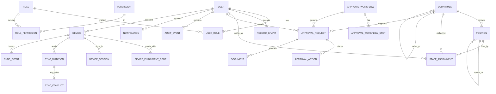

# TCOS Phase One: Database Schema (DRAFT FOR REVIEW)

Status: **proposal pending owner review; not yet implemented** (Slice 0 contains no models). Please review section 9 (open decisions) before approving.
Updated for the hybrid cloud and offline requirements: see section 8A and `docs/HYBRID_ARCHITECTURE.md`. Owner decisions recorded: English only; users may hold several roles.
Database: PostgreSQL. ORM: Django. Table names below are logical; Django will prefix with the app label (e.g. `accounts_user`).

## 1. Conventions

- Primary keys: UUID (`id`), except `audit_event` which uses a bigserial so insertion order is strict and cheap.
- Timestamps: `created_at`, `updated_at` (timestamptz, UTC; display in Africa/Dar_es_Salaam).
- Archival instead of deletion: `is_archived`, `archived_at`, `archived_by` on domain tables. Hard deletes only by explicit permission and always audited.
- `created_by` references `user` where relevant (nullable for system-created rows).
- Enumerations stored as short text with CHECK constraints (easier to migrate than native Postgres enums).
- Sensitive child information is not in Phase One tables. Later modules will add field-level protection; the document classification field below prepares for it.
- **Sync-ready convention for every offline-eligible table** (see section 8A): `id` is a UUID that the client may generate; `version` integer starting at 1 and incremented on every change; `updated_at`, `updated_by`; `last_device_id` (nullable); archival instead of deletion. Changes are made only through service functions that also append to the change log in the same transaction. Server-assigned values (such as official request numbers) are never created offline.

## 2. Entity overview

## 3. accounts

### `user` (custom user model, `AUTH_USER_MODEL`)

| Column | Type | Notes |
|---|---|---|
| id | uuid PK | |
| username | citext, unique | case-insensitive |
| email | citext, unique | |
| full_name | text | required |
| phone | text | validated, nullable |
| password | text | hashed by Django |
| department_id | FK department, nullable | **primary department** (denormalised convenience; source of truth is the primary `staff_assignment`, kept in sync in service layer) |
| position_id | FK position, nullable | same note |
| status | text | `ACTIVE`, `INACTIVE`, `LOCKED`, `PENDING` (CHECK) |
| is_active | bool | Django login gate; mirrors status |
| is_superuser | bool | reserved for emergency break-glass only; normal admins use the Administrator role |
| must_change_password | bool | set on admin-created accounts |
| password_changed_at | timestamptz | |
| failed_login_count | int | reset on success |
| locked_until | timestamptz, nullable | |
| two_factor_required | bool | per user override |
| last_login | timestamptz | |
| created_at / updated_at | timestamptz | |
| created_by | FK user, nullable | |

Indexes: unique(username), unique(email), (status), (department_id).

### `login_attempt`

| Column | Type | Notes |
|---|---|---|
| id | uuid PK | |
| username_attempted | text | as typed, truncated |
| user_id | FK user, nullable | null if account not found |
| success | bool | |
| failure_reason | text, nullable | internal only, never shown to client |
| ip_address | inet | |
| user_agent | text | |
| attempted_at | timestamptz | |

Indexes: (username_attempted, attempted_at), (ip_address, attempted_at). Used for lockout and rate decisions. Every row is also mirrored to `audit_event`.

### `totp_device`

id, user_id FK (unique per active device), secret_encrypted, is_confirmed, created_at, confirmed_at.

### `recovery_code`

id, user_id FK, code_hash, used_at (nullable), created_at.

### `password_reset_token`

id, user_id FK, token_hash (unique), requested_ip, expires_at, used_at (nullable), created_at. Token itself is never stored, only its hash. Single use.

Sessions: Django's database-backed session framework plus a `user_session` table (decided, see 9.9), so users can see and end their own sessions.

#### As built in Slice 2 (rbac, organisation)

- `organisation.department` exists in minimal form (id, code, name, is_active, timestamps). `user.department_id` (primary department) is added. Slice 4 extends the table.
- `permission` holds 120 seeded rows (15 modules x 8 actions). `role` has 11 seeded `is_system` roles. `role_permission` is seeded with the default grants (decision D-034).
- `role_permission.scope` and `permission.action` have CHECK constraints; `record_grant.action` too.
- `django.contrib.auth` groups and permissions are still installed but unused.

#### As built in Slice 1 (differences from the design above)

- `username` and `email` are `varchar`, normalised to lower case in code **and** enforced by `CHECK (col = lower(col))` plus unique constraints, instead of `citext` (no PostgreSQL extension needed). Email is optional-unique: `unique(email)`.
- `is_active` is **not** a column. It is derived from `status = 'ACTIVE'`, so it cannot disagree with `status`.
- `failed_login_count` and `locked_until` are **not** columns. Lockout is derived from `login_attempt` (5 failures in 15 minutes per username, 30 per IP). `lockout_reset_at` (timestamptz) lets an administrator clear a lockout; the screen for it arrives in Slice 6.
- `department_id` and `position_id` are deferred to Slice 4, when those tables exist.
- The first administrator created by `create_initial_admin` has `is_superuser = true` until Slice 2 provides the Administrator role.
- `django.contrib.auth` is installed, so its `auth_group` and `auth_permission` tables exist but are **unused**. TCOS uses its own RBAC tables from Slice 2.
- `login_attempt` records: username as typed (normalised, truncated), user if found, success, `failure_reason` (`BAD_CREDENTIALS`, `ACCOUNT_NOT_ACTIVE`, `THROTTLED`), IP, user agent, time.

### `user_session` (Slice 1)

| Column | Type | Notes |
|---|---|---|
| id | uuid PK | exposed to the user, used to end one session |
| user_id | FK user | |
| session_key | text, unique | key of the matching Django session. Never sent to clients. Stored in plain text, which is the same exposure as the `django_session` table itself |
| device_label | text | e.g. "Safari on iPhone", derived from the user agent |
| ip_address, user_agent | | informational |
| created_at, last_seen_at | timestamptz | `last_seen_at` is refreshed at most once a minute |
| ended_at, ended_reason | | `LOGOUT`, `IDLE_TIMEOUT`, `ABSOLUTE_TIMEOUT`, `SIGNED_OUT_BY_USER`, `PASSWORD_CHANGED` |

Slice 8 adds a nullable `device_id` link to the device registry (and replaces the planned `device_session` table with this one).

## 4. rbac

### `permission`

| Column | Type | Notes |
|---|---|---|
| id | uuid PK | |
| module | text | e.g. `administration`, `social_welfare`, `children`, `education`, `medical`, `finance`, `projects`, `hr`, `procurement`, `stores`, `donors`, `reports`, `approvals`, `audit`, `users` |
| action | text | CHECK in (`VIEW`,`CREATE`,`EDIT`,`DELETE`,`APPROVE`,`REJECT`,`EXPORT`,`MANAGE_USERS`) |
| description | text | |

Unique (module, action). Seeded; extended when later phases add modules.

### `role`

id, code (unique, e.g. `FINANCE_OFFICER`), name, description, is_system (cannot delete), is_active, created_at, updated_at.
Seeded roles: Board Member, Executive Director, Administrator, Social Welfare Officer, Education Officer, Medical Officer, Finance Officer, Project Manager, Storekeeper, Procurement Officer, HR Officer.

### `role_permission`

| Column | Type | Notes |
|---|---|---|
| id | uuid PK | |
| role_id | FK role | |
| permission_id | FK permission | |
| scope | text | CHECK in (`ALL`,`DEPARTMENT`,`OWN`,`ASSIGNED`) |
| granted_by / granted_at | | |

Unique (role_id, permission_id). Permissions are assigned independently, one row each.

Scope meanings: `ALL` every record in the module; `DEPARTMENT` records belonging to the user's department(s); `OWN` records the user created or is the subject of; `ASSIGNED` records explicitly assigned to the user (e.g. an approval waiting on them). **Scopes are cumulative** (decision D-035): ASSIGNED includes OWN; DEPARTMENT includes ASSIGNED and OWN; ALL includes everything.

### `user_role`

| Column | Type | Notes |
|---|---|---|
| id | uuid PK | |
| user_id | FK user | |
| role_id | FK role | |
| department_id | FK department, nullable | restricts this role to one department when set (department-specific access) |
| valid_from / valid_to | date, nullable | temporary or acting roles |
| granted_by / granted_at | | |

Unique (user_id, role_id, department_id) **among live assignments** (two partial unique indexes, because NULL department is its own case). A user may hold several roles; effective permission is the union, using the widest scope per (module, action). **As built:** adds `revoked_at` and `revoked_by`; removing a role keeps the row as history. A check constraint requires `valid_to >= valid_from`.

### `record_grant` (record-specific access)

| Column | Type | Notes |
|---|---|---|
| id | uuid PK | |
| user_id | FK user | |
| content_type_id | FK django_content_type | which kind of record |
| object_id | uuid | which record |
| action | text | same action set |
| expires_at | timestamptz, nullable | |
| granted_by / granted_at | | |
| revoked_at / revoked_by | | revocation recorded, not deleted |

Index (content_type_id, object_id), (user_id).

## 5. organisation

**Built in Slice 4** (tables `organisation_department`, `organisation_position`, `organisation_staffassignment`, `organisation_approvalhierarchy`). As built, beyond the draft below: every table also has `version` (rises on every change), `created_by`, `updated_by` and a declared sync policy (D-063). Database CHECKs and partial unique indexes enforce: no self-parent or self-boss, archived implies inactive with a stamp, one live head position per department, one current main assignment per person, no duplicate current assignment to a position, end date not before start, and each chain step naming exactly what its type needs. Cycles across several rows are prevented in the service layer (D-060). A position's department cannot change after creation. Chain `request_type` defaults to `DEFAULT`.

### `department`

id, code (unique), name, description, parent_id (self FK, nullable), head_id (FK user, nullable), is_active, is_archived (+ archived_at/by), created_at, updated_at.
CHECK: parent_id <> id. Cycle prevention in service layer plus tests.

### `position`

id, title, department_id FK, reports_to_position_id (self FK, nullable), is_department_head_position bool, is_active, is_archived, created_at, updated_at.
Unique (department_id, title). Cycle prevention as above.

### `staff_assignment`

| Column | Type | Notes |
|---|---|---|
| id | uuid PK | |
| user_id | FK user | |
| position_id | FK position | |
| department_id | FK department | |
| is_primary | bool | |
| reports_to_user_id | FK user, nullable | optional override of position-based reporting line |
| start_date / end_date | date, nullable | |

Partial unique index: one primary active assignment per user (`WHERE is_primary AND end_date IS NULL`).

### `approval_hierarchy` (department approval chains)

id, department_id FK, request_type, step_order, approver_type (`POSITION`,`ROLE`,`DEPARTMENT_HEAD`,`REPORTS_TO`,`USER`), approver_position_id / approver_role_id / approver_user_id (one set according to type; CHECK), is_active.
Unique (department_id, request_type, step_order). Consumed by the approval workflow resolver. (See open decision 9.3 on whether this merges with `approval_workflow_step`.)

## 6. approvals

### `approval_workflow`

id, code (unique), name, request_type, department_id (nullable = applies institution-wide), is_active.

### `approval_workflow_step`

id, workflow_id FK, step_order, approver_type, approver_position_id / approver_role_id / approver_user_id, required_permission (nullable), is_active. Unique (workflow_id, step_order).

### `request_sequence`

key (e.g. `REQ-2026`), last_value int. Row-locked (`SELECT ... FOR UPDATE`) to generate gap-free, unique, concurrency-safe numbers. Format: `TCOS-REQ-YYYY-NNNNNN`.

### `approval_request`

| Column | Type | Notes |
|---|---|---|
| id | uuid PK | |
| request_number | text, unique | assigned at first submission (drafts may use a draft marker) |
| request_type | text | |
| title | text | |
| description | text | |
| requester_id | FK user | requesting employee |
| department_id | FK department | |
| workflow_id | FK approval_workflow, nullable | |
| current_step | int, nullable | |
| assigned_approver_id | FK user, nullable | |
| status | text | CHECK in (`DRAFT`,`SUBMITTED`,`UNDER_REVIEW`,`APPROVED`,`REJECTED`,`CANCELLED`) |
| submitted_at | timestamptz, nullable | |
| decided_at | timestamptz, nullable | |
| decision_comment | text, nullable | |
| related_content_type_id / related_object_id | nullable | link to a future record (e.g. purchase, leave request) |
| local_reference | text, nullable | temporary reference shown for an offline draft (e.g. `LOCAL-7F3A`) until the server assigns `request_number` |
| risk_level | text | `LOW`, `MEDIUM`, `HIGH` (CHECK); set by the server from request type and amount thresholds, never by the client |
| created_offline | bool | true when the request was first created on a device while offline |
| origin_device_id | FK device, nullable | device it was created or submitted from |
| client_created_at | timestamptz, nullable | the device's claimed time; informational only, never used for ordering or authority |
| version | int | sync version, starts at 1 |
| created_at / updated_at | | |

CHECK: `assigned_approver_id <> requester_id`. Indexes: unique(request_number), (status), (assigned_approver_id, status), (requester_id), (department_id, status), (submitted_at).

### `approval_action` (append-only history)

| Column | Type | Notes |
|---|---|---|
| id | uuid PK | |
| request_id | FK approval_request | |
| step_order | int, nullable | |
| actor_id | FK user | |
| action | text | `CREATE`,`SUBMIT`,`REVIEW`,`APPROVE`,`REJECT`,`CANCEL`,`COMMENT`,`REASSIGN` |
| from_status / to_status | text | |
| comment | text, nullable | mandatory when action = `REJECT` (CHECK) |
| created_at | timestamptz | |

Protected by an UPDATE/DELETE-blocking trigger like the audit table. A trigger additionally rejects `APPROVE`/`REJECT`/`REVIEW` rows where `actor_id` equals the request's `requester_id` (defence in depth; the service layer enforces it first).

Valid transitions (enforced in service layer, mirrored by tests):
DRAFT→SUBMITTED; SUBMITTED→UNDER_REVIEW; UNDER_REVIEW→APPROVED|REJECTED; DRAFT|SUBMITTED|UNDER_REVIEW→CANCELLED. APPROVED, REJECTED, CANCELLED are terminal.

## 7. audit

### `audit_event` (append-only) — built in Slice 3 as table `audit_auditevent`

| Column | Type | Notes |
|---|---|---|
| id | bigserial PK | strict ordering |
| occurred_at | timestamptz | default now(), set by DB |
| actor_id | FK user, nullable | null for failed logins and system actions |
| actor_username | text | snapshot, survives user changes |
| event_type | text | e.g. `LOGIN_SUCCESS`, `LOGIN_FAILED`, `USER_CREATED`, `USER_UPDATED`, `USER_DEACTIVATED`, `PERMISSION_CHANGED`, `ROLE_ASSIGNED`, `RECORD_CREATED`, `RECORD_UPDATED`, `RECORD_ARCHIVED`, `RECORD_DELETED`, `APPROVAL_DECISION`, `DATA_EXPORTED`, `DOCUMENT_UPLOADED`, `DOCUMENT_DOWNLOADED` |
| object_type | text | model label |
| object_id | text | |
| department_id | FK department, nullable | enables department-scoped audit viewing |
| changes | jsonb | before/after, secrets and sensitive fields excluded |
| metadata | jsonb | extra context |
| success | bool | |
| ip_address | inet | |
| user_agent | text | |
| request_id | text | correlates entries from one request |
| prev_hash / event_hash | text | tamper-evident chain: sha256 over the event's fields and the previous hash; the first event follows 64 zeros (decided, D-046) |

Indexes: (occurred_at), (actor_id, occurred_at), (event_type, occurred_at), (object_type, object_id), (department_id, occurred_at).

**Immutability, three layers:**
1. No update/delete code paths or API endpoints.
2. Trigger `BEFORE UPDATE OR DELETE OR TRUNCATE` raises an exception.
3. The application connects as a database role with `INSERT, SELECT` only on this table; migrations run as a separate owner role.

As built: the app model refuses changes; trigger `audit_event_no_row_change` (UPDATE, DELETE) and `audit_event_no_truncate` (TRUNCATE) raise for every role; role `tcos_app` has SELECT and INSERT only. Inserts take an advisory lock so the chain has one order. A table owner or database superuser can still bypass the triggers, so the hash chain (`verify_audit_chain`) and an off-site copy of the head hash provide detection at that level.

## 8. core

### `notification`

id, recipient_id FK user, type, title, body, link (internal route), related_content_type/object, created_at, read_at (nullable). Index (recipient_id, read_at, created_at).

### `document`

| Column | Type | Notes |
|---|---|---|
| id | uuid PK | |
| content_type_id / object_id | | parent record (generic) |
| original_filename | text | |
| storage_key | text, unique | random, not derived from filename |
| mime_type, size_bytes | | validated server-side |
| sha256 | text | |
| classification | text | `NORMAL`, `CONFIDENTIAL`, `CHILD_SENSITIVE` |
| uploaded_by / uploaded_at | | |
| is_archived (+at/by) | | |

Files live in private storage outside any public or static path; access only through an authenticated, permission-checked endpoint.

### `reference_figure`

| Column | Type | Notes |
|---|---|---|
| key | text PK | `total_children`, `residential_children`, `outreach_children`, `total_employees` |
| value | int | 85, 42, 43, 15 |
| source_note | text | "Initial institutional reference figure" |
| is_verified | bool | default false |
| verified_by / verified_at | | |

The dashboard reports `source: "reference"` while no live records exist, and `source: "live"` afterwards. Values are never presented as verified until someone verifies them.

### `system_setting`

key, value (jsonb), description, updated_by, updated_at. For lockout thresholds, session timeouts, upload limits, required-2FA roles.

## 8A. devices and sync (hybrid cloud and offline)

Design rationale and protocol: `docs/HYBRID_ARCHITECTURE.md`. Tables below are created in Slices 8 and 9; the sync-ready columns in section 1 are applied from Slice 1.

### `device`

| Column | Type | Notes |
|---|---|---|
| id | uuid PK | generated by the server at registration |
| name | text | e.g. "Finance laptop" |
| device_type | text | `COMPUTER`, `TABLET`, `SMARTPHONE` (CHECK) |
| assigned_user_id | FK user, nullable | |
| status | text | `PENDING_ENROLMENT`, `ACTIVE`, `REVOKED`, `EXPIRED` (CHECK) |
| trust_level | text | `STANDARD`, `TRUSTED`; `TRUSTED` is the only level that could ever cache `CHILD_SENSITIVE` data, and only if the owner enables it (D-H1) |
| public_key | text, nullable | set at enrolment; private key is non-extractable on the device |
| registered_by / registered_at | | an administrator |
| enrolled_at | timestamptz, nullable | |
| last_seen_at / last_sync_at | timestamptz, nullable | |
| lease_expires_at | timestamptz, nullable | offline lease, renewed at every successful check-in |
| revoked_at / revoked_by / revoke_reason | | |
| wipe_acknowledged_at | timestamptz, nullable | when the device confirmed it erased local data |

Indexes: (status), (assigned_user_id), (lease_expires_at).

### `device_enrolment_code`

id, device_id FK, code_hash (the code itself is shown once and never stored), expires_at, used_at (nullable), created_by, created_at. Single use.

### `device_session` (superseded: Slice 1 built `user_session`; Slice 8 adds `device_id` to it instead of creating this table)

id, session_key_hash (unique), user_id FK, device_id FK (nullable for unregistered devices), created_at, ended_at (nullable), ended_reason (`LOGOUT`, `IDLE`, `REVOKED`, `PASSWORD_RESET`, `USER_DEACTIVATED`). Lets the server end every session on a revoked device immediately.

### `sync_change` (change log, append-only)

| Column | Type | Notes |
|---|---|---|
| seq | bigserial PK | pull cursor; append takes a transaction-level advisory lock so log order equals commit order |
| entity_type | text | registered model label |
| entity_id | uuid | |
| operation | text | `UPSERT`, `TOMBSTONE` |
| version | int | record version after the change |
| department_id | FK department, nullable | used to decide who may receive the change |
| classification | text | `NORMAL`, `CONFIDENTIAL`, `CHILD_SENSITIVE` |
| changed_at / changed_by | | |
| source_device_id | FK device, nullable | |

Deliberately holds **no copy of record content**. Content is read from the live row at pull time and filtered by the requester's current permissions. Indexes: (entity_type, entity_id), (changed_at).

### `sync_mutation` (idempotency and outcome log)

| Column | Type | Notes |
|---|---|---|
| id | uuid PK | |
| device_id | FK device | |
| mutation_id | uuid | generated on the device |
| user_id | FK user | |
| entity_type / entity_id | | |
| operation | text | `CREATE`, `UPDATE`, `ARCHIVE` |
| base_version | int, nullable | version the device edited from |
| changed_fields | jsonb | only the fields the device changed |
| status | text | `APPLIED`, `MERGED`, `CONFLICT`, `REJECTED`, `REQUIRES_ONLINE`, `QUARANTINED` (CHECK) |
| result_version | int, nullable | |
| reason_code / reason_detail | text, nullable | plain-language reason for rejections |
| client_created_at | timestamptz | informational only |
| received_at / applied_at | timestamptz | server time, authoritative |
| review_status | text, nullable | for `QUARANTINED`: `PENDING`, `ACCEPTED`, `DISCARDED` |
| reviewed_by / reviewed_at | | |
| request_id | text | correlates with audit events |

**Unique (device_id, mutation_id)**: a resent mutation returns the stored outcome and is never applied twice. Indexes: (user_id, received_at), (status), (entity_type, entity_id).

### `sync_conflict`

id, mutation_id FK, user_id FK, entity_type, entity_id, base_version, server_version, server_snapshot jsonb, proposed_changes jsonb, status (`OPEN`, `RESOLVED_SERVER`, `RESOLVED_MINE`, `RESOLVED_EDITED`, `DISCARDED`), resolved_by, resolved_at, resolution_mutation_id (nullable), created_at. Open conflicts are never auto-expired.

### `sync_event` (synchronisation and error history, append-only)

id, occurred_at, user_id, device_id, direction (`PULL`, `PUSH`), applied_count, merged_count, conflict_count, rejected_count, error_code (nullable), error_message (plain language, nullable), duration_ms, client_app_version, protocol_version. Protected from update and delete like `audit_event`. Users see their own rows; administrators see all.

## 9. Open decisions for your review

1. ~~**Roles per user**~~ **Decided: users may hold several roles.** Effective permission is the union, using the widest scope per (module, action). Tests must cover multi-role users, including a role that is department-restricted combined with one that is not.
2. **Scope semantics:** is `DEPARTMENT` scope enough for sensitive modules (e.g. should the Medical Officer see only medical records regardless of department)? Likely handled by module permissions, but confirm.
3. **Approval hierarchy tables:** keep `approval_hierarchy` (department chains) and `approval_workflow_step` separate, or merge into one? Draft keeps both for clarity; merging reduces complexity.
4. **Single-step or multi-step approvals in Phase One?** Draft supports multi-step. Single-step would be faster to build and test.
5. ~~**Audit hash chain:**~~ **Decided: included (D-046).** Was: include tamper-evident hashing now (more work, stronger evidence for auditors and donors), or rely on DB permissions and off-site backups?
6. **Requester is the only possible approver** (e.g. Executive Director requesting something with no superior): escalate to Board Member role, or block and require an administrator to reassign? Needs a policy.
7. **Default permission grants per role:** I will propose a matrix in Slice 2 for you to correct. Do you already have a view on who may approve what (e.g. spending limits)?
8. ~~**Language**~~ **Decided: English only.** No translation framework is needed.
9. ~~**Session management**~~ **Decided: yes.** Visible "where you are signed in" list, per-device sign out and "sign out all other devices". Idle timeout 30 minutes, absolute timeout 12 hours.
10. **Data protection:** confirm that Tanzania's Personal Data Protection Act obligations (and any donor safeguarding rules) have been reviewed, since child modules in Phase Two will depend on the classification and encryption approach set here.
11. **Hosting region:** hosting location affects data residency and latency from Shinga. Decide before deployment, not before Slice 0. With a cloud database this becomes a firm requirement, not a nice-to-have.
12. **Hybrid and offline decisions D-H1 to D-H8** (child-sensitive caching, offline lease length, offline approvals, risk thresholds in TZS, inactivity lock time, device types, who manages devices, quarantine policy) are listed with proposed defaults in `docs/HYBRID_ARCHITECTURE.md` section 14.

## 10. What this schema deliberately does not include yet

Children, education, medical, finance, projects, HR records, procurement, stores, donors, reports. These arrive in later phases as separate apps. The `permission` table, generic document attachments, `related_content_type` links on requests, the `audit` hook and the sync policy registry and change log (section 8A) are the extension points that let them plug in without restructuring. A later module is not complete until it has declared a sync policy.
